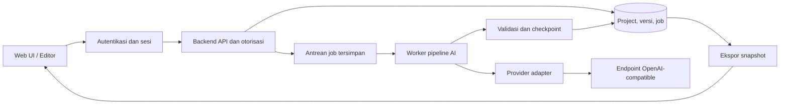

# Scriptify — Rencana Produk dan Implementasi

Status: usulan awal, belum implementasi. Tanggal: 11 Oktober 2026.

## 1. Tujuan

Membantu kreator membuat paket produksi YouTube long-form: naskah utuh, narasi per scene, arahan visual, dan prompt untuk menghasilkan visual yang sesuai narasi. Jenis konten awal: dokumenter, penjelasan finansial, sejarah, teknologi, edukasi, dan topik kustom.

Keberhasilan utama: pengguna dapat mengubah ide menjadi paket naskah dan scene yang konsisten, mengedit sebagian hasil, lalu mengekspornya untuk proses produksi.

## 2. Asumsi rancangan

- Target yang sudah dipilih pengguna: web app online untuk banyak pengguna.
- MVP menggunakan workspace pribadi per akun. Berbagi project dan workspace tim menjadi pengembangan lanjutan.
- Usulan pembiayaan API: bring your own key (BYOK), yaitu setiap pengguna memasukkan API key provider sendiri. Akun dengan saldo/biaya AI yang ditanggung aplikasi dapat ditambahkan kemudian.
- Hanya alur long-form; tidak ada template atau konversi Shorts pada versi awal.
- Preset target durasi 10, 15, 20, dan 30 menit, dengan input durasi kustom. Ini pilihan produk, bukan definisi resmi batas long-form YouTube.
- Narasi default Bahasa Indonesia; bahasa naskah dan bahasa prompt visual dapat dipilih terpisah.
- Rasio visual default 16:9, dapat dikonfigurasi untuk kebutuhan video panjang lain.
- Satu narator default. Struktur data mendukung beberapa speaker dan atribusi kutipan; sintesis suara belum termasuk MVP.
- MVP menghasilkan prompt visual dan arahan produksi. Generasi gambar/video, TTS, dan rendering video merupakan pengembangan lanjutan.
- Model dan provider dipilih pengguna melalui endpoint OpenAI-compatible; tidak mengunci model tertentu.

## 3. Batas MVP

### Termasuk

1. Membuat, menyimpan, membuka, menduplikasi, dan mengarsipkan project.
2. Brief: topik, sudut pandang, audiens, kategori, durasi, bahasa, gaya narasi, kedalaman pembahasan, tujuan video, dan CTA opsional.
3. Referensi berupa teks yang ditempel beserta judul, URL asal opsional, penerbit, dan tanggal sumber.
4. Outline yang bisa ditinjau dan diedit sebelum pembuatan naskah.
5. Naskah utuh dengan struktur hook, konteks, bab pembahasan, transisi, dan penutup sesuai template.
6. Pemisahan naskah menjadi scene oleh AI, dengan output utama: ID/judul scene dan estimasi durasi, narasi, serta prompt gambar/video.
7. Pilihan jenis prompt gambar atau video. Satu prompt utama per scene secara default; rincian beberapa shot dan catatan produksi tersedia sebagai opsi lanjutan.
8. Edit manual, regenerate bagian tertentu, penguncian bagian yang sudah cocok, autosave, dan riwayat versi.
9. Pengaturan provider, tes koneksi, input model manual, serta pemilihan model dari daftar jika tersedia.
10. Progress per tahap, retry terbatas, cancel, resume setelah gangguan, serta catatan penggunaan token bila provider menyediakannya.
11. Ekspor TXT/Markdown untuk naskah utuh dan rangkaian blok scene sesuai format utama, CSV untuk tabel scene, dan JSON untuk paket produksi.
12. Registrasi/login, verifikasi email, pemulihan akun, logout, dan sesi aman melalui penyedia/library autentikasi yang dipilih saat implementasi.
13. Isolasi data per akun, API key terenkripsi, kuota aplikasi, batas job aktif, dan pembatasan laju request per pengguna.
14. Penghapusan project/akun beserta kebijakan retensi, serta administrasi operasional minimum untuk memantau job dan kegagalan tanpa menampilkan secret.

### Setelah MVP

- Riset web otomatis, ekstraksi URL/PDF, serta konektor pencarian terpisah.
- Generasi gambar atau video langsung, preview storyboard bergambar, dan TTS.
- Timestamp subtitle berdasarkan audio yang sudah dibuat.
- Kolaborasi tim, billing berlangganan, saldo AI terpusat, dan publikasi ke YouTube.
- Ekspor DOCX/PDF dan integrasi editor video.

## 4. Alur pengguna

Project baru → brief + sumber → outline → tinjau/edit outline → generate naskah → tinjau/edit naskah → pecah scene → generate prompt visual → tinjau hasil → ekspor.

Pengguna dapat kembali ke tahap sebelumnya. Perubahan pada tahap awal menandai hasil turunannya sebagai perlu diperbarui, tanpa menghapus versi lama atau menimpa edit manual secara diam-diam.

Mode generate otomatis seluruh tahap dapat ditambahkan setelah alur bertahap stabil.

## 5. Pipeline AI

Peran berikut merupakan tahap terstruktur dalam satu orchestrator. Tidak memerlukan framework multi-agent atau proses agent terpisah pada MVP.

| Tahap | Input | Hasil | Pemeriksaan |
| --- | --- | --- | --- |
| Brief & evidence preparation | Brief dan teks referensi | Ringkasan kebutuhan, daftar fakta/klaim, istilah, sumber | Bedakan informasi dari sumber dan usulan model |
| Outline planner | Brief, bukti, target durasi | Bab, tujuan tiap bab, alokasi kata, hook | Cakupan topik dan total alokasi |
| Script writer | Outline dan bukti terkait | Narasi lengkap per bab | Alur, repetisi, istilah, panjang, rujukan klaim |
| Script reviewer | Naskah dan sumber | Temuan dan revisi yang dapat ditinjau | Angka, tanggal, kontradiksi, klaim tanpa dukungan |
| Scene segmenter | Versi naskah yang dipilih | Batas scene dan pemetaan ke narasi asli | Cakupan tepat sekali, urutan benar, tidak mengubah kata |
| Visual director | Scene, jenis prompt, dan panduan visual global | Prompt gambar atau video per scene; rincian shot opsional | Relevansi narasi, konsistensi, kelayakan visual |
| Final validator | Seluruh artefak | Paket produksi dan daftar temuan | Integritas pemetaan, schema, durasi, dependensi versi |

Pemeriksaan AI menghasilkan usulan dan temuan, bukan jaminan bahwa klaim telah benar. Validasi struktur dan cakupan narasi dilakukan oleh kode.

### Penanganan naskah panjang

- Buat naskah per bab menggunakan outline global, daftar istilah, dan ringkasan kesinambungan antarbab.
- Berikan hanya sumber yang relevan untuk tiap bab, dengan ID sumber tetap.
- Tetapkan anggaran kata per bab sebelum generasi, lalu periksa panjang aktual.
- Simpan checkpoint tiap tahap/bab agar proses dapat dilanjutkan.
- Tinjau kontinuitas setelah semua bab selesai; pecah scene dari versi naskah hasil tinjauan.
- Scene dibentuk berdasarkan perubahan gagasan, lokasi, waktu, atau kebutuhan visual. Jangan memaksakan satu paragraf menjadi satu scene.

## 6. Sumber kebenaran dan sinkronisasi

Naskah tersimpan sebagai versi berisi unit narasi berurutan dengan ID stabil. Tampilan naskah utuh dirangkai dari unit tersebut. Scene menyimpan referensi ke unit/rentang teks pada versi yang sama, bukan salinan narasi yang bisa menyimpang secara independen.

AI mengusulkan rentang scene; sistem memvalidasi bahwa seluruh narasi tercakup tepat sekali, tanpa celah, tumpang tindih, atau perubahan urutan. Jika sebuah unit harus dibagi, simpan rentang teks yang eksplisit dan tervalidasi.

- Edit narasi melalui scene membuat revisi naskah dan memperbarui tampilan naskah utuh.
- Perubahan narasi menandai pemetaan scene, durasi, dan prompt visual terkait sebagai perlu diperiksa atau diperbarui.
- Perubahan panduan visual menandai prompt visual terdampak sebagai perlu diperbarui.
- Mengubah prompt visual saja tidak memicu penulisan ulang naskah.
- Regenerate menghasilkan revisi yang dapat dibandingkan dan diterapkan; bagian terkunci tidak ditimpa.
- Hasil job untuk versi lama tidak boleh menggantikan versi terbaru.
- Ekspor selalu mengambil snapshot versi yang konsisten. Jika masih ada hasil lama, pengguna memilih memperbaruinya atau mengekspor dengan status tersebut tercatat.

## 7. Bentuk hasil per scene

Mengikuti contoh pengguna, tampilan dan ekspor utama menggunakan tiga komponen berikut secara berurutan:

1. `Scene: ID — Judul (estimasi durasi)`.
2. `Narasi: "Potongan naskah asli untuk scene tersebut."`.
3. `Prompt gambar: "..."` atau `Prompt video: "..."`, sesuai jenis output yang dipilih.

Label `Prompt gambar/video` dapat digunakan sebagai label umum di rancangan; hasil yang disalin atau diekspor menyebut jenis prompt yang sebenarnya. Default satu blok prompt utama per scene. Metadata tambahan di bawah disimpan untuk sinkronisasi, pemeriksaan, dan pengaturan lanjutan; tidak wajib ditampilkan pada setiap blok output.

| Elemen | Isi |
| --- | --- |
| Identitas | ID scene, urutan, bab, judul singkat |
| Narasi | Teks dari rentang naskah asli dan speaker ID |
| Penyampaian | Nada, emosi, penekanan, jeda opsional |
| Waktu | Estimasi durasi serta waktu mulai/selesai yang dihitung aplikasi |
| Tujuan | Fungsi scene dalam cerita atau penjelasan |
| Visual | Jenis visual, subjek, setting, komposisi, pencahayaan, mood |
| Shot | Satu atau lebih shot, narasi terkait, dan pembagian durasi |
| Prompt | Jenis gambar/video dan teks prompt; prompt video mencakup aksi serta pergerakan kamera yang relevan |
| Produksi | Teks layar, transisi, musik/SFX opsional, kata kunci footage |
| Bukti | Referensi klaim/sumber dan status pemeriksaan |

Contoh ilustratif:

```text
Scene: SC-004 — Daya beli (estimasi 10–12 detik)
Narasi: "Bayangkan Anda membawa anggaran belanja yang sama ke pasar.
         Kali ini, hanya sebagian barang yang bisa Anda bawa pulang."
Prompt gambar: "Editorial documentary illustration of two shopping
                baskets on a neutral market counter, the same budget
                represented by identical envelopes beside each basket,
                fewer groceries in the second basket, natural lighting,
                muted warm palette, clean composition, 16:9,
                no embedded text, no fabricated price labels."
```

Estimasi contoh mengacu pada sekitar 22 kata dengan asumsi 140 kata/menit ditambah jeda singkat. Contoh visual merupakan ilustrasi konsep, tanpa menyatakan data harga aktual.

Untuk mode video, prompt menambahkan urutan aksi, gerakan kamera, dan tempo yang sesuai narasi, misalnya kamera bergerak perlahan dari keranjang pertama ke keranjang kedua. Durasi scene mengikuti narasi; jika alat video tujuan memiliki batas durasi klip lebih pendek, pengguna dapat membuka rincian shot untuk membaginya menjadi beberapa klip tanpa mengubah narasi. Pilihan jenis prompt tidak berarti gambar atau video langsung dibuat oleh aplikasi pada MVP.

Prompt mengikuti panduan visual global: gaya, palet, periode waktu, karakter/lokasi berulang, rasio, dan hal yang harus dihindari. Jangan mengandalkan seed lintas provider untuk menjamin konsistensi.

Untuk grafik finansial, keluarkan spesifikasi grafik dan data bersumber. Angka, label, serta sumbu dirender secara deterministik; model gambar tidak dijadikan sumber data grafik. Arsip nyata menggunakan kata kunci pencarian footage dan catatan sumber, sedangkan rekonstruksi diberi label sebagai ilustrasi.

## 8. Estimasi durasi

Durasi narasi diperkirakan dari jumlah kata dibagi kecepatan bicara yang dipilih pengguna, ditambah jeda. Default awal yang diusulkan: 140 kata/menit, dapat diubah dan dikalibrasi setelah ada rekaman suara.

Contoh perencanaan: 15 menit × 140 kata/menit = sekitar 2.100 kata sebelum mengalokasikan jeda. Angka ini adalah asumsi produk, bukan jaminan durasi audio.

Total durasi shot mengikuti estimasi scene dan total scene mengikuti estimasi video. Timestamp MVP diberi label estimasi; timestamp subtitle presisi menunggu audio/alignment pada fase berikutnya.

## 9. Integrasi OpenAI-compatible

Bangun provider adapter dengan konfigurasi: nama profil, base URL, secret API key, model ID, timeout, batas output, dan kemampuan provider/model. Satu profil default cukup untuk MVP; pemilihan model berbeda per tahap dapat ditambahkan kemudian.

Kontrak dasar yang direncanakan memakai Chat Completions. Dokumentasi OpenAI mendefinisikan endpoint tersebut; kompatibilitas provider pihak ketiga harus diuji tersendiri. [Referensi Chat Completions](https://developers.openai.com/api/reference/resources/chat/subresources/completions/methods/create).

Strategi output, sesuai kemampuan yang terverifikasi:

1. JSON Schema/Structured Outputs bila tersedia.
2. JSON mode dengan validasi schema oleh aplikasi.
3. Output teks yang diminta berbentuk JSON, diikuti parsing, validasi, dan perbaikan terbatas.

JSON mode tidak menjamin hasil sesuai schema. Semua jalur tetap memerlukan validasi aturan bisnis, penanganan respons terpotong, penolakan model, dan error. [Dokumentasi Structured Outputs](https://developers.openai.com/api/docs/guides/structured-outputs?api-mode=chat).

Tes koneksi memeriksa autentikasi dan respons teks sederhana. Pemeriksaan kemampuan terpisah memastikan dukungan format terstruktur dan parameter opsional. Jangan mengasumsikan semua model mendukung streaming, tools, temperature, atau parameter token yang sama.

Fallback hanya untuk ketidakcocokan fitur yang dikenali; error autentikasi tidak boleh disamarkan sebagai masalah format. Jika daftar model tidak tersedia, input ID model manual tetap dapat dipakai. Jangan beralih provider secara otomatis karena itu mengubah tujuan pengiriman data.

API key dikelola backend, dienkripsi saat disimpan menggunakan kunci enkripsi yang terpisah dari database, disamarkan di UI, dan tidak dimasukkan ke log atau ekspor. API key hanya dibuka untuk request milik pengguna tersebut; pengguna dapat mengganti atau menghapusnya. Semua komunikasi publik memakai HTTPS. Pengguna dapat melihat provider tujuan pemrosesan naskah.

Endpoint kustom wajib HTTPS dan dibatasi untuk mencegah server mengakses jaringan internal: tolak localhost, alamat privat/link-local, endpoint metadata cloud, dan redirect menuju tujuan terlarang; periksa resolusi DNS pada saat koneksi. Terapkan kontrol egress jaringan. Profil awal dapat memakai daftar host yang diizinkan, dengan penambahan host kustom melalui konfigurasi admin. Provider pada komputer lokal pengguna tidak bisa diakses langsung dari server publik tanpa integrasi khusus, sehingga bukan bagian MVP.

## 10. Arsitektur yang diusulkan



Usulan stack awal: React + TypeScript untuk UI, Node.js + TypeScript untuk API dan worker, PostgreSQL untuk penyimpanan banyak pengguna, serta secret manager untuk kunci enkripsi aplikasi. Pemilihan framework, layanan hosting, layanan autentikasi, dan versi paket ditetapkan saat implementasi. Ini pilihan rancangan, bukan dependensi yang sudah dipasang.

Worker menjalankan proses panjang di luar siklus request halaman. Antrean job persisten dapat menggunakan PostgreSQL pada MVP, dengan pengambilan job secara atomik, lease/heartbeat, dan pemulihan job yang terputus. Worker berjalan sebagai proses terpisah dan dapat ditambah sesuai beban. Redis/broker khusus dipertimbangkan saat kebutuhan throughput mengharuskannya. Antarmuka memantau status job melalui endpoint yang memeriksa pemilik job.

Setiap project, profil provider, sumber, versi, job, dan ekspor harus terkait pemilik akun/workspace. Backend memeriksa kepemilikan pada setiap operasi baca/tulis, polling, regenerate, dan ekspor; jangan mempercayai owner ID yang dikirim client. Worker memuat secret berdasarkan pemilik job, bukan profil global. File ekspor sementara memakai akses privat dan tautan berumur pendek bila disimpan di object storage.

Batasi job aktif per pengguna, ukuran input, jumlah percobaan, dan jumlah output. Jadwalkan antrean secara adil agar satu akun tidak menghabiskan kapasitas. Catat event operasional dengan ID akun/job dan redaksi konten sensitif. Siapkan backup database, uji pemulihan, health check worker, dan prosedur rotasi kunci sebelum rilis publik.

Entitas inti: User, Workspace, Project, Brief, Source, Claim, OutlineVersion, ScriptVersion, NarrationUnit, Speaker, SceneVersion, Shot, VisualStyle, ProviderProfile, GenerationJob, StageRun, UsageRecord, dan ExportSnapshot. Satu workspace pribadi dibuat per akun; keanggotaan tim belum menjadi fitur. Klaim merujuk sumber; scene merujuk versi naskah; shot merujuk scene. Tabel dapat disederhanakan saat implementasi selama kepemilikan, relasi, dan versi tetap terjaga.

## 11. Antarmuka

- Dashboard: daftar project, status tahap terakhir, durasi target, dan aksi lanjutkan.
- Akun: login/registrasi, profil, pemulihan akses, pemakaian/kuota aplikasi, dan penghapusan akun.
- Project workspace: tab Brief, Sumber, Outline, Naskah, Scene & Visual, Ekspor.
- Editor: daftar bab/scene di kiri, isi aktif di tengah, metadata/sumber/temuan di kanan.
- Tampilan scene default: kartu berisi judul/estimasi durasi, narasi, dan prompt gambar/video sesuai contoh pengguna; sediakan salin narasi, salin prompt, dan salin seluruh scene.
- Detail scene dapat dibuka untuk speaker, sumber, catatan produksi, serta rincian shot. Tampilan tabel ringkas tersedia sebagai alternatif.
- Settings: provider, tes koneksi, model, parameter yang didukung, dan preferensi bahasa.
- Progress: tahap aktif, bab/scene yang selesai, hasil parsial, serta aksi cancel/retry.
- Riwayat versi: perubahan manual dan hasil AI dapat dibandingkan serta dipulihkan.

## 12. Keandalan, kualitas, dan biaya

- Setiap job memiliki status queued, running, completed, failed, atau cancelled; simpan tahap terakhir yang berhasil dan input versinya.
- Retry sementara menggunakan jeda meningkat dan batas percobaan. Perbaikan format memiliki batas terpisah agar tidak berulang tanpa akhir.
- Resume tidak membuat artefak lokal ganda. Gangguan jaringan setelah provider memproses request tetap dapat menimbulkan biaya ulang; catat percobaan secara transparan.
- Cancel menghentikan tahap selanjutnya dan membatalkan request aktif bila didukung. Hasil parsial yang valid tetap tersimpan.
- Catat token aktual bila tersedia. Estimasi biaya hanya muncul jika tarif profil model dikonfigurasi; jika tidak, tampilkan bahwa biaya belum diketahui.
- Sumber diperlakukan sebagai bahan referensi, bukan instruksi untuk agent. Klaim yang tidak didukung sumber ditandai.
- Untuk finansial, simpan tanggal acuan, unit/mata uang, periode, dan sumber angka. AI tidak boleh membuat URL sumber, angka pasar terbaru, atau klaim telah diverifikasi tanpa bukti yang tersedia.
- Sumber yang hanya berupa URL tanpa teks belum dianggap telah dibaca pada MVP.
- Tentukan retensi log, ekspor sementara, project terhapus, dan backup. Penghapusan akun menghentikan job, mencabut secret aktif, serta menghapus data utama; jelaskan jadwal kedaluwarsa salinan backup kepada pengguna.
- Anggaran token/job dan kuota aplikasi mengendalikan pemakaian di Scriptify; ini bukan jaminan batas tagihan pada akun provider eksternal pengguna.
- Pemeriksaan kualitas mencakup repetisi, transisi bab, istilah konsisten, hook yang sesuai isi, dan janji pembahasan yang benar-benar dipenuhi.

## 13. Tahap implementasi dan hasil yang diuji

| Tahap | Lingkup | Kriteria selesai |
| --- | --- | --- |
| 1 — Fondasi banyak pengguna | Autentikasi, kepemilikan data, PostgreSQL, project/brief, secret dan provider | Dua akun terisolasi; project persisten; koneksi provider diuji; key tidak terekspos |
| 2 — Naskah | Referensi teks, outline, naskah per bab, job dan checkpoint | Naskah dapat ditinjau/diedit; proses gagal dapat dilanjutkan; versi tersimpan |
| 3 — Scene & visual | Segmentasi, speaker, shot, prompt, panduan visual | Seluruh narasi terpetakan tepat sekali; tiap shot terkait scene yang benar |
| 4 — Penyuntingan & ekspor | Regenerate parsial, lock, sinkronisasi, riwayat, ekspor | Edit manual terlindungi; hasil lama ditandai; ekspor satu snapshot konsisten |
| 5 — Validasi dan rilis | Alur lengkap, isolasi akun, batas kapasitas, backup dan deployment | Dokumenter dan penjelasan finansial lolos evaluasi; akses silang ditolak; worker dapat pulih |

Pengujian utama:

1. Integrasi provider terkonfigurasi dan fixture untuk strict JSON, JSON mode, serta plain-text JSON; mencakup 401, rate limit, timeout, respons terpotong, dan schema tidak valid.
2. Naskah panjang dapat diselesaikan per bab tanpa kehilangan kontinuitas referensi dan urutan narasi.
3. Pemisahan scene membuktikan tidak ada teks hilang, ganda, atau berubah diam-diam.
4. Perubahan naskah menandai output terkait; edit prompt tidak menulis ulang narasi.
5. Job versi lama tidak menimpa perubahan terbaru; resume/cancel/retry tidak menggandakan artefak.
6. Ekspor cocok dengan versi yang dipilih, lengkap dengan narasi, scene, prompt, dan referensi sumber.
   Format TXT/Markdown scene mengikuti tiga komponen utama; metadata/sumber tambahan hanya disertakan bila dipilih. Prompt video menyertakan arahan gerak, sedangkan prompt gambar mendeskripsikan komposisi statis.
7. Evaluasi manusia atas relevansi visual, kualitas narasi, dan dukungan bukti; pemeriksaan otomatis saja tidak cukup untuk kualitas editorial.
8. Dua akun tidak dapat membaca/mengubah project, job, sumber, profil provider, atau ekspor satu sama lain, termasuk dengan menebak ID dan mengakses tautan langsung.
9. Endpoint kustom tidak dapat mengakses jaringan privat/metadata cloud, termasuk lewat redirect atau perubahan DNS; secret tidak muncul di log, respons UI, dan ekspor.
10. Batas konkurensi dan kuota bekerja lintas worker; job pulih setelah proses mati; backup dapat dipulihkan dan penghapusan akun menghentikan proses terkait.

## 14. Keputusan yang masih terbuka

- BYOK saja untuk MVP atau juga menyediakan model/kuota yang dibayar aplikasi; baseline usulan adalah BYOK.
- Penyedia hosting dan autentikasi sesuai anggaran serta kebutuhan operasional.
- Provider/model pertama yang akan benar-benar diuji.
- Rentang durasi yang paling sering dipakai untuk menentukan batas uji MVP.
- Prioritas setelah MVP: riset otomatis, generasi visual, atau TTS.

Keputusan ini dapat diperbarui tanpa mengubah tujuan inti: naskah long-form yang konsisten dengan narasi per scene dan prompt visualnya.
